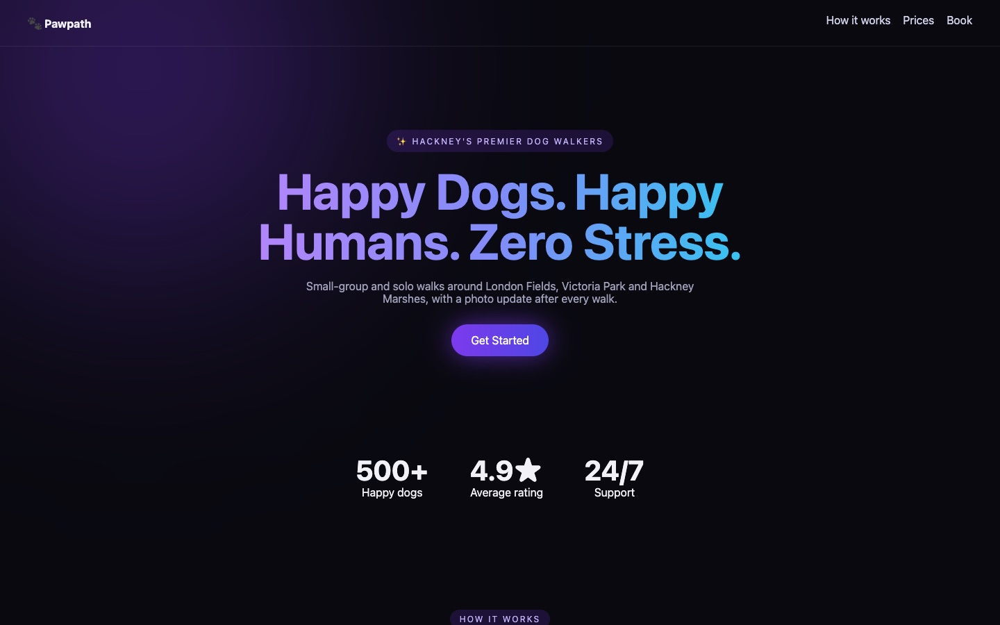
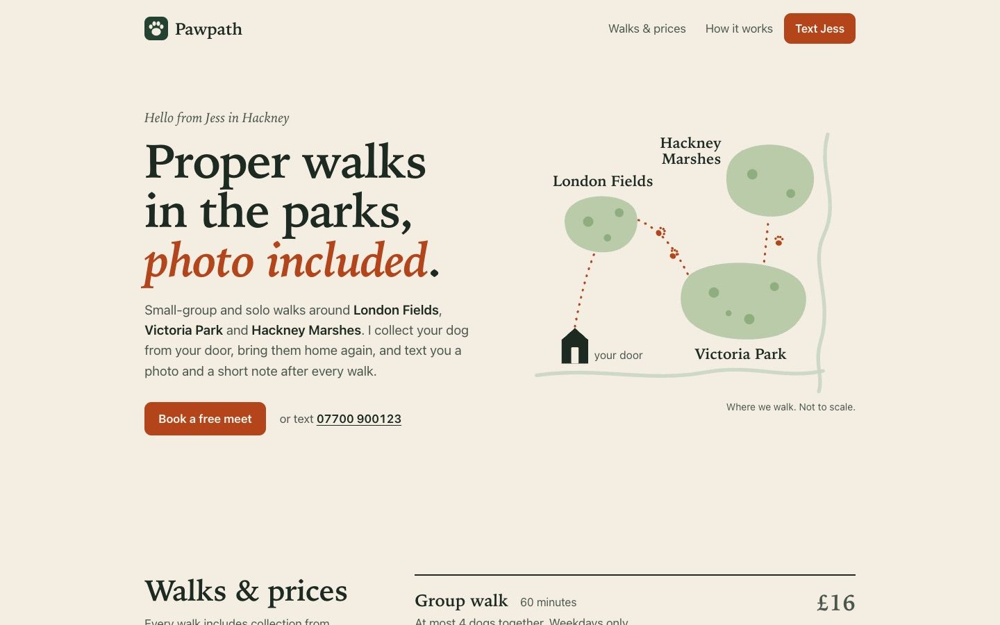
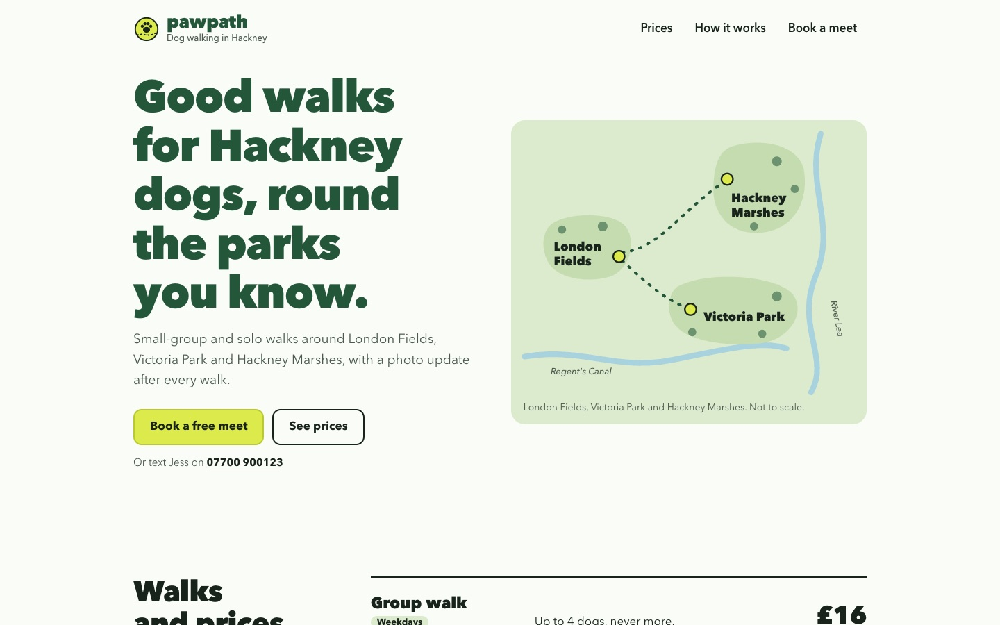
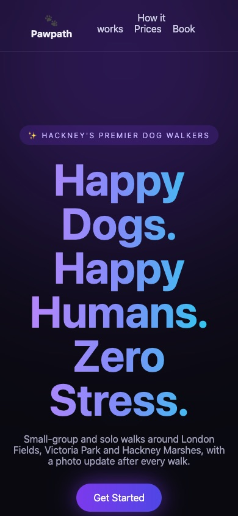
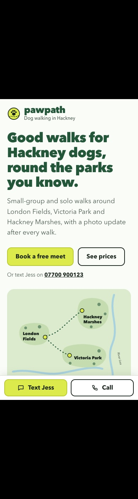

# Case study: Pawpath

Pawpath is a made-up one-person dog-walking business in Hackney, built as an eval fixture. The starting page is what agents produce when nobody pushes back: dark background, violet-to-cyan gradient headline, a glowing blob, glass header, a pulsing "Get Started" button, emoji in circles, and a "500+ happy dogs / 4.9★ / 24/7 support" strip with nothing behind it. The price table overflowed every phone.

The request, word for word:

> It looks like every AI-generated landing page and nothing like a friendly local dog walker. Can you give it a proper identity that fits the business? Keep all the real information (walks, prices, areas, contact details) and make sure it works well on phones.

## Before

## First attempt: out of one default, into another

With astack 0.4 the agent escaped the purple template, kept every fact and fixed mobile. A blind judge scored it 20 out of 20 against 14 for the run without astack.

It also landed on warm cream, a big serif headline and a terracotta accent, which is the single most common look AI design produces right now. The judge didn't catch it, and neither did the skill, because astack's anti-pattern list described last year's defaults.

## After the fix

astack 0.5 names the current defaults, makes the agent write a token plan and test it ("would I make this for any similar brief?") before building, and `slop-scan.mjs` now flags the cream-serif-terracotta combination.

| Before, phone | After, phone |
| --- | --- |
|  |  |

Same request, a direction taken from the subject: park greens, the canal and the River Lea on a sketch map of the three parks Jess walks, and a tennis-ball yellow used only for things you can tap. The unsupported stats are gone, the price table compares at a glance on a phone, a call bar sits at the bottom of the screen, and the decisions are written into [DESIGN.md](../examples/pawpath/DESIGN.md) for the next change. The scanner finds nothing on it.

It isn't perfect. The headline is bigger than it needs to be and a few paragraphs leave short last lines, which `shoot.mjs` reports. Those are the next pass.

Source: [before](../examples/pawpath/before.html) · [after](../examples/pawpath/index.html)
